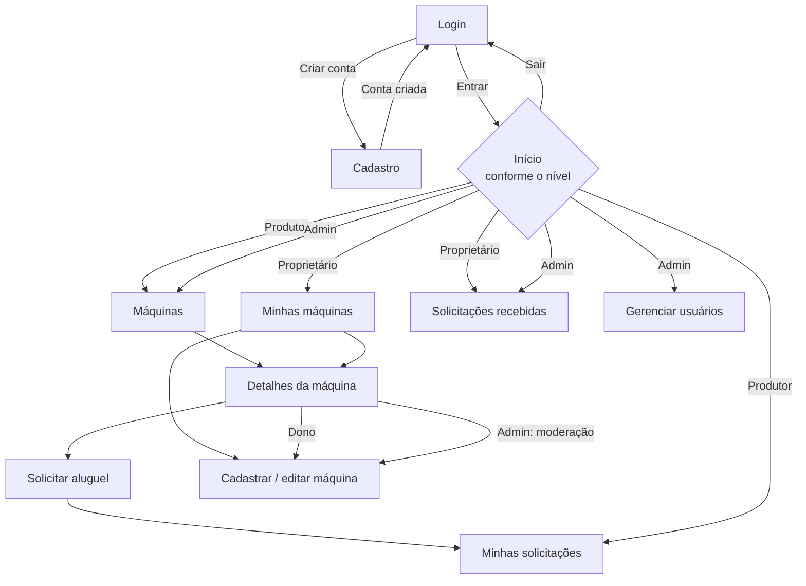

# 🚜 TRAKTO — Aluguel fácil de máquinas e serviços agrícolas

> **Conectando quem precisa com quem tem.**

Aplicação mobile (React Native + Expo) que conecta **pequenos produtores rurais** que precisam de máquinas agrícolas a **proprietários com maquinário ocioso**, por meio de um fluxo simples de anúncio, busca e solicitação de aluguel.

**Autor:** Guilherme Dalke — 3º ano do Ensino Médio Técnico
**Projeto Avaliativo:** Aplicação Mobile com JWT e Níveis de Usuário

   

> 📄 **Documento completo da proposta** — personas, requisitos funcionais e não funcionais, regras de negócio, modelo de dados e rotas da API: **[docs/PROPOSTA.md](docs/PROPOSTA.md)**

| Entrega | Conteúdo | Situação |
|---|---|---|
| 1 | Proposta, estrutura inicial, telas e navegação | ✅ Entregue |
| 2 | Modelagem, MySQL, API Express e integração com `fetch()` | ⏳ Próxima |
| 3 | Cadastro, login, hash, JWT, níveis, rotas protegidas e CRUD completo | ⏳ |
| 4 | Testes, correções, APK e apresentação | ⏳ |

---

## 1. Problema identificado

O acesso a máquinas agrícolas ainda é um desafio para a agricultura familiar:

- Muitos **pequenos produtores não possuem maquinário próprio** e dependem de favores, empréstimos informais ou de prestadores difíceis de encontrar.
- **Comprar máquinas novas tem custo muito alto** — um trator de pequeno porte pode custar o equivalente a vários anos de lucro de uma pequena propriedade.
- Ao mesmo tempo, **existem máquinas ociosas** na região que passam boa parte do ano paradas.
- **Falta uma forma simples de conectar quem precisa com quem tem.** Hoje a negociação acontece de boca a boca, por grupos de mensagens ou por telefone, sem organização de datas, preços e disponibilidade.

## 2. Contexto e público afetado

- **Região-foco:** Vale do Taquari (RS), onde **mais de 80% dos agricultores são de base familiar** (fonte: IBGE).
- **Público potencial estimado:** de **40 a 45 mil produtores** apenas no Vale do Taquari.
- **Público-alvo:**
  - **Produtores rurais** (principalmente pequenos e familiares) que precisam de máquinas por algumas horas ou dias;
  - **Proprietários de máquinas** (produtores maiores, prestadores de serviço, cooperativas) que querem gerar renda com equipamentos parados.

## 3. Justificativa

Em uma pesquisa inicial com agricultores e empresários locais, a ideia teve **90% de aprovação**. Uma plataforma de aluguel compartilhado:

- **reduz custos** de produção para quem não pode comprar máquinas;
- **aumenta a renda** de quem tem máquinas ociosas;
- **melhora o aproveitamento** do maquinário já existente na região;
- **facilita o acesso à tecnologia** no campo e incentiva a **economia de uso compartilhado**.

O celular é o meio mais acessível para o produtor rural, por isso a solução é um **aplicativo mobile**.

## 4. Proposta de solução

A **TRAKTO** é um aplicativo onde:

1. o **proprietário** anuncia suas máquinas (tipo, potência, cidade, preço por hora e disponibilidade);
2. o **produtor** busca máquinas por nome, cidade e tipo, vê os detalhes e **solicita o aluguel** informando data e horas — o app calcula o valor estimado;
3. o proprietário **aceita ou recusa** a solicitação; quando aceita, o **contato (WhatsApp) é liberado** para as duas partes combinarem os detalhes;
4. após o serviço, a solicitação é marcada como **concluída**;
5. o **administrador** gerencia usuários e níveis de acesso e modera anúncios irregulares.

**Diferencial em relação a um catálogo simples:** a TRAKTO tem um **fluxo de status entre dois usuários** e **permissões por dono do registro** (cada proprietário só edita as próprias máquinas e só responde a pedidos das próprias máquinas).

```
Produtor solicita ──► PENDENTE ──► Proprietário aceita ──► ACEITA ──► CONCLUÍDA
                         │                    │
                         │                    └─► Proprietário recusa ──► RECUSADA
                         └─► Produtor cancela ──► CANCELADA
```

**Fora do escopo** (possíveis evoluções futuras): pagamento dentro do app, cobrança automática da comissão, mapa/GPS, chat interno e avaliações.

## 5. Tipos de usuário e permissões

| Funcionalidade | Produtor | Proprietário | Admin |
|---|:---:|:---:|:---:|
| Criar conta e fazer login | ✅ | ✅ | ✅ |
| Buscar e ver detalhes de máquinas | ✅ | ✅ | ✅ |
| Solicitar aluguel | ✅ | — | — |
| Ver e cancelar **as próprias** solicitações | ✅ | — | — |
| Cadastrar, editar e excluir **as próprias** máquinas | — | ✅ | — |
| Aceitar, recusar e concluir solicitações **das próprias** máquinas | — | ✅ | — |
| Ver todas as solicitações | — | — | ✅ |
| Editar ou remover **qualquer** anúncio (moderação) | — | — | ✅ |
| Gerenciar usuários e alterar níveis | — | — | ✅ |

- No cadastro público o usuário escolhe entre **Produtor** e **Proprietário**. O nível **Admin** só pode ser concedido por outro administrador.
- As regras estão centralizadas em **[`constants/permissoes.js`](constants/permissoes.js)** (`pode(usuario, acao)` e `podeAlterarMaquina`) e são usadas tanto pela navegação quanto pelas telas.
- Na Entrega 3, cada permissão será **validada no back-end** (middleware que lê o JWT enviado como *Bearer Token* e confere o nível e o dono do registro). Esconder botões no app é apenas visual.

## 6. Principais funcionalidades

- Cadastro com escolha de perfil e login
- Página inicial personalizada por nível (indicadores e atalhos)
- Busca de máquinas por texto, filtro por tipo e por disponibilidade
- Detalhes da máquina e do anunciante
- Solicitação de aluguel com cálculo do valor estimado
- Acompanhamento de solicitações por status (pendente, aceita, recusada, concluída, cancelada)
- CRUD de máquinas pelo proprietário (entidade principal)
- Resposta às solicitações recebidas (aceitar, recusar, concluir)
- Gerenciamento de usuários e níveis pelo administrador

## 7. Telas

| # | Tela | Arquivo | Quem acessa |
|---|---|---|---|
| 1 | Login | `screens/publico/Login.js` | público |
| 2 | Criar conta | `screens/publico/CadastroUsuario.js` | público |
| 3 | Início (painel por nível) | `screens/comum/Home.js` | todos logados |
| 4 | Máquinas disponíveis (busca e filtros) | `screens/comum/Maquinas.js` | todos logados |
| 5 | Detalhes da máquina | `screens/comum/DetalhesMaquina.js` | todos logados |
| 6 | Solicitar aluguel | `screens/produtor/SolicitarAluguel.js` | produtor |
| 7 | Minhas solicitações | `screens/produtor/MinhasSolicitacoes.js` | produtor |
| 8 | Minhas máquinas | `screens/proprietario/MinhasMaquinas.js` | proprietário |
| 9 | Cadastrar / editar máquina | `screens/proprietario/FormularioMaquina.js` | proprietário, admin |
| 10 | Solicitações recebidas | `screens/proprietario/SolicitacoesRecebidas.js` | proprietário, admin |
| 11 | Gerenciar usuários | `screens/admin/Usuarios.js` | admin |

## 8. Fluxo de navegação



A navegação usa **React Navigation (native stack)**. As telas disponíveis mudam conforme o login: sem sessão, apenas *Login* e *Cadastro*; com sessão, a pilha é montada de acordo com o nível do usuário (o botão Voltar não reabre uma sessão encerrada).

## 9. Estrutura do projeto

```text
trakto/
├── App.js                    # estado da sessão e dos dados + ações (entrar, salvar, alterar status…)
├── index.js                  # ponto de entrada do Expo
├── app.json                  # nome, ícones, splash e pacote Android
├── navigation/
│   └── Rotas.js              # React Navigation: rotas públicas e privadas guiadas por permissão
├── screens/                  # telas agrupadas por perfil de acesso
│   ├── publico/              # Login, CadastroUsuario
│   ├── comum/                # Home, Maquinas, DetalhesMaquina
│   ├── produtor/             # SolicitarAluguel, MinhasSolicitacoes
│   ├── proprietario/         # MinhasMaquinas, FormularioMaquina, SolicitacoesRecebidas
│   └── admin/                # Usuarios
├── components/
│   ├── ui/                   # biblioteca visual: Botao, Campo, Cartao, Chip, Aviso, Toast, Avatar…
│   ├── Logo.js               # marca da TRAKTO
│   ├── CartaoMaquina.js      # cartão da listagem de máquinas
│   ├── CartaoSolicitacao.js  # cartão do pedido com linha do tempo e contato
│   ├── LinhaDoTempo.js       # Enviada → Aceita → Concluída
│   ├── Indicador.js          # número de destaque dos painéis
│   └── AcaoRapida.js         # atalhos da tela inicial
├── constants/
│   ├── permissoes.js         # níveis e matriz de permissões (pode / podeAlterarMaquina)
│   └── negocio.js            # comissão, limites, tipos de máquina, ciclo de status
├── theme/
│   └── tema.js               # design system: cores, espaçamentos, raios, fontes, sombras
├── utils/
│   └── formatadores.js       # moeda, máscaras de data/telefone, validações
├── services/
│   └── dadosFicticios.js     # dados de demonstração (substituído pela API na Entrega 2)
├── assets/                   # ícone, ícone adaptativo Android, splash, favicon
└── docs/
    └── PROPOSTA.md           # documento completo da proposta
```

**Camadas:** as *telas* só montam a interface; as *regras* (permissões, comissão, status) ficam em `constants/`; o *visual* vem de `theme/` + `components/ui/`; os *dados* chegam pelo `App.js` (hoje em memória, na Entrega 2 via `services/api.js` com `fetch()`). Assim a troca para a API real não exige reescrever as telas.

## 10. Identidade visual

| Cor | Hex | Uso |
|---|---|---|
| 🟩 Verde lavoura | `#2E5B34` | cor principal, botões |
| 🟨 Amarelo trigo | `#E8A93A` | destaques e chamadas |
| 🟫 Marrom terra | `#8B5E3C` | etiquetas e detalhes |
| ⬜ Palha | `#F7F4EC` | fundo |

O símbolo é um **"T" com dois sulcos de lavoura** em amarelo trigo. Ícones: Material Community Icons (`@expo/vector-icons`, já incluído no Expo). Os valores ficam em [`theme/tema.js`](theme/tema.js).

## 11. Tecnologias

**Entrega 1:** React Native · Expo SDK 58 · React Navigation 7 (native stack) · @expo/vector-icons · JavaScript (ES Modules)
**Próximas entregas:** Node.js · Express · MySQL (mysql2) · bcryptjs · jsonwebtoken · AsyncStorage · EAS Build (APK)

## 12. Como executar

Pré-requisitos: Node.js 20+ e o app **Expo Go** no celular (ou um emulador Android).

```bash
npm install
npx expo start
```

- Leia o QR Code com o Expo Go (o celular precisa estar na mesma rede Wi-Fi), ou
- pressione `w` para abrir no navegador, ou `a` para abrir no emulador Android.

### Contas de demonstração (Entrega 1)

Nesta etapa os dados ficam **em memória** (arquivo `services/dadosFicticios.js`) e voltam ao estado inicial quando o app é reiniciado. Na tela de login há botões que preenchem cada conta:

| Perfil | E-mail | Senha |
|---|---|---|
| Produtor | `produtor@trakto.com` | `123456` |
| Proprietário | `proprietario@trakto.com` | `123456` |
| Admin | `admin@trakto.com` | `123456` |

> ⚠️ Estas senhas são apenas para demonstração. A partir da Entrega 3 as senhas serão armazenadas com **hash (bcrypt)** no MySQL e a sessão será controlada por **JWT**.

## 13. Roteiro de teste rápido

1. Entre como **Produtor** → toque na busca → filtre por *Trator* → abra o **Trator Valtra A750** → *Solicitar aluguel* (data futura + 6 h) → o pedido aparece como **Pendente** em *Minhas solicitações*, com a linha do tempo.
2. Saia e entre como **Proprietário** → o alerta mostra os pedidos aguardando → **Aceitar** → o WhatsApp do produtor é liberado → *Marcar serviço como concluído* → a renda (já sem a comissão de 10%) aparece no Início.
3. Ainda como proprietário → *Anunciar máquina* → publique → abra em *Minhas máquinas* → **Editar** → **Excluir** (com confirmação). Tente abrir a máquina de outro proprietário: não há botões de edição.
4. Entre como **Admin** → *Usuários* → altere o nível de um usuário (o próprio nível fica bloqueado) → *Moderar anúncios* → remova um anúncio.
5. Volte ao login como **Produtor**: as telas de proprietário e admin não existem na navegação desse perfil.

---

*O projeto de loja online usado em aula serviu apenas como **referência técnica** de arquitetura (sessão no `App.js`, componentes por Props e futura API com JWT). Tema, problema, regras de negócio, telas e identidade visual são autorais.*
