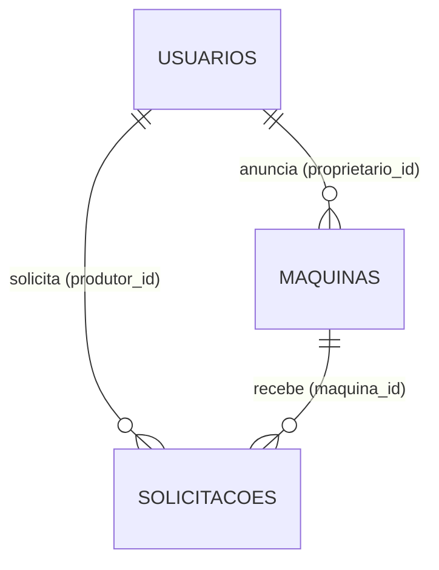

# Entrega 2 — Modelagem, banco de dados e integração

```
App React Native ──fetch()──▶ API Express (backend/) ──mysql2──▶ MySQL (database/trakto.sql)
```

## 1. Modelagem dos dados



| Tabela | Campos | Regras no banco |
|---|---|---|
| **usuarios** | id, nome, email, senha (hash bcrypt), telefone, cidade, nivel, criado_em, atualizado_em | `email` UNIQUE · `nivel` ENUM(produtor, proprietario, admin) |
| **maquinas** (entidade principal) | id, proprietario_id, nome, tipo, potencia, cidade, preco_hora, disponivel, com_operador, descricao, criado_em, atualizado_em | FK → usuarios · `tipo` ENUM · CHECK `preco_hora > 0` · índices em tipo, cidade, disponivel |
| **solicitacoes** | id, maquina_id, produtor_id, data_servico, horas, valor_total, status, observacao, criado_em, atualizado_em | FKs → maquinas e usuarios · `status` ENUM(pendente, aceita, recusada, concluida, cancelada) · CHECK horas 1–200 |

- `valor_total` é calculado **pela API** (preço/hora × horas) e guardado, para que mudanças futuras de preço não alterem pedidos antigos.
- Script completo e comentado: [`database/trakto.sql`](../database/trakto.sql). Dados de demonstração: `npm run db:popular` ([`backend/scripts/popularBanco.js`](../backend/scripts/popularBanco.js)).

## 2. Estrutura da API

```text
backend/
├── server.js                 # inicia o servidor e testa a conexão com o MySQL
├── app.js                    # Express: CORS, JSON, rotas, 404 e tratamento de erros
├── config/ambiente.js        # lê e valida backend/.env
├── database/conexao.js       # pool de conexões mysql2
├── routes/                   # authRoutes, maquinasRoutes, solicitacoesRoutes, usuariosRoutes
├── controllers/              # regras de cada recurso (SQL sempre com parâmetros "?")
├── middlewares/              # identificarUsuario (provisório) e exigirPermissao
├── utils/validacoes.js       # validação de todos os dados recebidos
├── scripts/popularBanco.js   # dados de demonstração com senhas em hash
├── tests/                    # testes automáticos (npm test)
└── requisicoes.http          # exemplos de chamadas para testar no VS Code/Postman
```

A API importa a **mesma matriz de permissões** do app (`constants/permissoes.js`) e as mesmas regras de negócio (`constants/negocio.js`): uma única fonte de regras para o app e para o servidor.

## 3. Rotas

| Método | Rota | Quem pode | O que faz |
|---|---|---|---|
| GET | `/saude` | público | Confere API e banco |
| POST | `/auth/cadastro` | público | Cria conta (senha → hash bcrypt; nunca cria admin) |
| POST | `/auth/login` | público | Confere e-mail e senha (`bcrypt.compare`) |
| GET | `/maquinas` | logado | Lista (filtros `busca`, `tipo`, `cidade`, `disponivel`, `proprietarioId`) |
| GET | `/maquinas/:id` | logado | Detalha |
| POST | `/maquinas` | proprietário | Cria anúncio (dono = usuário logado) |
| PUT | `/maquinas/:id` | dono ou admin | Edita |
| DELETE | `/maquinas/:id` | dono ou admin | Exclui (409 se houver aluguel pendente/aceito) |
| GET | `/solicitacoes` | logado | Produtor: as suas · Proprietário: das suas máquinas · Admin: todas |
| POST | `/solicitacoes` | produtor | Cria pedido; valor calculado no servidor |
| PATCH | `/solicitacoes/:id/status` | dono (aceita/recusada/concluida) · produtor (cancelada) | Muda status respeitando o ciclo |
| GET | `/usuarios` | admin | Lista usuários |
| PATCH | `/usuarios/:id/nivel` | admin | Altera nível (não o próprio) |
| GET | `/usuarios/eu` | logado | Dados de quem está logado |

Respostas de erro sempre em JSON `{ "mensagem": "..." }` com o código HTTP adequado: 400 (dados inválidos), 401 (não identificado), 403 (sem permissão), 404, 409 (conflito de regra) e 500.

> **Provisório (Entrega 2):** o app informa quem está logado no cabeçalho `X-Usuario-Id`. Na **Entrega 3** ele será trocado por `Authorization: Bearer <JWT>` validado no middleware `autenticarToken`, sem mudar controllers nem permissões.

## 4. Integração do app

- [`services/api.js`](../services/api.js) concentra todas as chamadas `fetch()` (GET, POST, PUT, PATCH, DELETE), trata falha de rede e mostra as mensagens da API.
- O `App.js` carrega máquinas, solicitações e usuários da API após o login; toda ação (anunciar, editar, excluir, solicitar, aceitar, cancelar, mudar nível) grava no MySQL e recarrega os dados.
- As telas têm "puxar para atualizar", indicadores de carregamento e mensagens de erro vindas do servidor. A tela de login mostra se a API/banco estão conectados.
- Os dados fictícios (`services/dadosFicticios.js`) foram removidos: tudo agora vem do banco.

## 5. Requisitos atualizados

| ID | Requisito | Situação |
|---|---|---|
| RF01–RF02 | Cadastro e login | ✅ via API, senha com hash bcrypt |
| RF04–RF05 | Listar/filtrar e detalhar máquinas | ✅ GET `/maquinas` |
| RF06–RF07 | Solicitar e cancelar aluguel | ✅ POST e PATCH `/solicitacoes` |
| RF08 | CRUD de máquinas | ✅ GET/POST/PUT/DELETE `/maquinas` |
| RF09–RF10 | Responder pedidos; contato só após aceite | ✅ telefone liberado pelo servidor |
| RF11–RF13 | Admin: usuários, moderação, todos os pedidos | ✅ |
| RF14 | Persistência em MySQL via API REST | ✅ **Entrega 2** |
| RF15 | JWT, Bearer Token, rotas protegidas por token, logout com sessão salva | ⏳ Entrega 3 |
