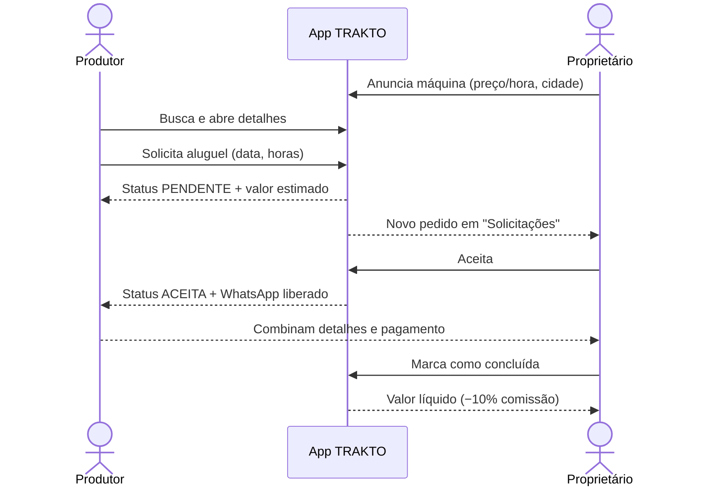
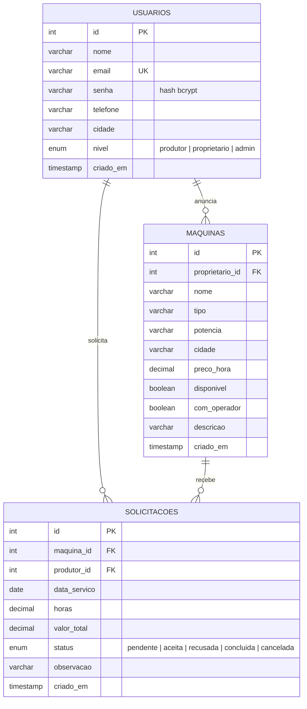

# TRAKTO — Documento de Proposta (Entrega 1)

**Aluno:** Guilherme Dalke · **Projeto Avaliativo:** Aplicação Mobile com JWT e Níveis de Usuário
**Versão:** 0.1 (Entrega 1 — proposta e estrutura inicial)

---

## 1. Problema

> **Pequenos produtores rurais não têm acesso fácil a máquinas agrícolas, enquanto máquinas da mesma região ficam paradas boa parte do ano.**

| Fato | Consequência |
|---|---|
| Muitos pequenos produtores **não possuem maquinário próprio**. | Atrasam plantio e colheita, ou fazem trabalho manual mais lento. |
| **Comprar máquinas novas tem custo muito alto** para a agricultura familiar. | O investimento não se paga em propriedades pequenas. |
| **Máquinas ociosas** ficam paradas fora da safra. | Proprietários perdem uma fonte de renda. |
| A negociação acontece **de boca a boca, por telefone ou grupos de mensagens**. | Sem organização de datas, preços, disponibilidade e histórico. |

**Pergunta orientadora:** *como um aplicativo pode conectar, de forma simples e organizada, quem precisa de uma máquina a quem tem uma parada?*

## 2. Contexto e público afetado

- **Região-foco:** Vale do Taquari (RS) — **mais de 80% dos agricultores são de base familiar** (IBGE).
- **Público potencial:** estimativa de **40 a 45 mil produtores** apenas no Vale do Taquari.
- **Pesquisa inicial** (entrevistas com agricultores e empresários locais): **90% de aprovação** da ideia.

### Personas

| | **João, 47 anos — produtor** | **Marta, 52 anos — proprietária** |
|---|---|---|
| Situação | 8 hectares de milho e feijão em Lajeado. Não tem trator. | Tem trator, semeadeira e grade em Estrela. Usa-os poucas semanas por ano. |
| Dor | Precisa de máquina por poucas horas e não sabe a quem pedir. | Máquinas paradas geram custo e nenhuma renda. |
| O que espera do app | Encontrar uma máquina perto, saber o preço e pedir rápido. | Anunciar, receber pedidos organizados e decidir quem atender. |

## 3. Justificativa

1. **Econômica:** reduz o custo de produção de quem aluga e gera renda extra para quem anuncia.
2. **Social:** fortalece a agricultura familiar e a cooperação entre produtores da mesma comunidade.
3. **Ambiental:** melhor aproveitamento das máquinas existentes (economia de uso compartilhado).
4. **Tecnológica:** o celular já é a ferramenta mais acessível no campo — um app simples reduz a barreira de entrada.

## 4. Proposta de solução

Aplicativo mobile **TRAKTO** (React Native + Expo) em que:

1. o **proprietário** anuncia máquinas com tipo, potência, cidade, preço por hora, operador e disponibilidade;
2. o **produtor** busca e filtra máquinas, vê os detalhes e **solicita o aluguel** (data + horas), com o **valor estimado calculado na hora**;
3. o proprietário **aceita ou recusa** o pedido; ao aceitar, o **WhatsApp das partes é liberado**;
4. depois do serviço, o pedido é marcado como **concluído** — a TRAKTO retém uma **comissão de 10%** (modelo de negócio de 8% a 12% definido na pesquisa);
5. o **administrador** gerencia usuários e níveis e **modera anúncios**.

### Objetivos

- **Geral:** criar uma plataforma digital que conecte produtores rurais que precisam de máquinas com proprietários que desejam alugá-las.
- **Específicos:** (1) desenvolver um protótipo funcional; (2) validar a aceitação entre produtores e prestadores; (3) estabelecer um modelo de comissão sustentável; (4) promover o uso de tecnologia na agricultura familiar.

## 5. Tipos de usuário

| Nível | Quem é | Como obtém o nível |
|---|---|---|
| **Produtor** (`produtor`) | Agricultor que precisa alugar máquinas. | Escolhe no cadastro. |
| **Proprietário** (`proprietario`) | Dono de máquinas que quer gerar renda. | Escolhe no cadastro. |
| **Administrador** (`admin`) | Equipe TRAKTO. | **Somente** promovido por outro admin. |

## 6. Permissões

A matriz abaixo está implementada em [`constants/permissoes.js`](../constants/permissoes.js) e é usada pela navegação (`navigation/Rotas.js`) e pelas telas.

| Ação (chave no código) | Produtor | Proprietário | Admin |
|---|:---:|:---:|:---:|
| `buscarMaquinas` — buscar e ver detalhes | ✅ | ✅ | ✅ |
| `solicitarAluguel` | ✅ | — | — |
| `verMinhasSolicitacoes` — ver/cancelar as **próprias** | ✅ | — | — |
| `gerenciarMinhasMaquinas` — CRUD das **próprias** máquinas | — | ✅ | — |
| `responderSolicitacoes` — aceitar/recusar/concluir pedidos **das próprias** máquinas | — | ✅ | — |
| `verTodasSolicitacoes` | — | — | ✅ |
| `moderarAnuncios` — editar/remover **qualquer** anúncio | — | — | ✅ |
| `gerenciarUsuarios` — alterar níveis | — | — | ✅ |

**Regra de dono do registro:** além do nível, o sistema confere *de quem* é o registro (`podeAlterarMaquina`). Um proprietário não edita a máquina de outro.
**Na Entrega 3**, a mesma matriz será aplicada no **back-end**: middleware valida o JWT (Bearer Token), identifica o nível e responde **401** (sem token) ou **403** (sem permissão).

## 7. Requisitos funcionais

| ID | Requisito | Perfil | Status E1 |
|---|---|---|:---:|
| RF01 | Cadastrar conta com nome, e-mail, telefone, cidade, senha e perfil | Público | ✅ (em memória) |
| RF02 | Entrar com e-mail e senha | Público | ✅ (em memória) |
| RF03 | Sair da conta | Todos | ✅ |
| RF04 | Listar máquinas com busca por texto, filtro por tipo e disponibilidade, e ordenação por preço | Todos | ✅ |
| RF05 | Ver detalhes da máquina e do anunciante | Todos | ✅ |
| RF06 | Solicitar aluguel informando data e horas, com valor estimado | Produtor | ✅ |
| RF07 | Listar e cancelar as próprias solicitações pendentes | Produtor | ✅ |
| RF08 | Cadastrar, listar, editar e excluir as próprias máquinas (CRUD) | Proprietário | ✅ |
| RF09 | Aceitar, recusar e concluir solicitações das próprias máquinas | Proprietário | ✅ |
| RF10 | Liberar o contato (WhatsApp) somente após o aceite | Sistema | ✅ |
| RF11 | Gerenciar usuários e alterar níveis de acesso | Admin | ✅ |
| RF12 | Moderar (editar/remover) qualquer anúncio | Admin | ✅ |
| RF13 | Acompanhar todas as solicitações da plataforma | Admin | ✅ |
| RF14 | Persistir dados no MySQL via API REST | Sistema | ⏳ E2 |
| RF15 | Senha com hash (bcrypt), login com JWT e rotas protegidas | Sistema | ⏳ E3 |

## 8. Requisitos não funcionais

| ID | Requisito |
|---|---|
| RNF01 | App em **React Native com Expo**, rodando em Android (APK final), com suporte a web para testes. |
| RNF02 | API **REST** com **Node.js + Express** e banco **MySQL** (Entrega 2). |
| RNF03 | Senhas armazenadas **somente como hash** (bcrypt); nenhum segredo no repositório (`.env` no `.gitignore`). |
| RNF04 | Autenticação por **JWT** enviado no cabeçalho `Authorization: Bearer <token>`. |
| RNF05 | Permissões validadas **no back-end**; esconder botões no app é apenas usabilidade. |
| RNF06 | Interface legível ao ar livre: alto contraste, botões grandes (≥ 48 px) e textos claros, pensando no usuário do campo. |
| RNF07 | Código organizado em camadas (telas, componentes, navegação, regras, serviços) e versionado no Git com commits frequentes. |

## 9. Regras de negócio

| ID | Regra |
|---|---|
| RN01 | O cadastro público só permite os níveis **produtor** e **proprietário**. |
| RN02 | Um administrador **não pode alterar o próprio nível** (evita perder o último acesso administrativo). |
| RN03 | Só é possível solicitar máquinas **disponíveis**. |
| RN04 | A data do aluguel deve ser **válida e de hoje em diante**; horas entre **1 e 200**. |
| RN05 | **Valor total = preço por hora × horas.** |
| RN06 | Ciclo da solicitação: `pendente → aceita → concluída`, `pendente → recusada` ou `pendente → cancelada`. Só o produtor cancela; só o dono da máquina aceita/recusa/conclui. |
| RN07 | O telefone das partes só aparece após o aceite. |
| RN08 | A comissão TRAKTO é de **10%** sobre aluguéis concluídos; o proprietário vê o valor líquido. |

## 10. Telas previstas

| # | Tela | Perfil | Funções principais |
|---|---|---|---|
| 1 | Login | Público | Entrar, atalhos de demonstração, link para cadastro |
| 2 | Criar conta | Público | Escolha de perfil, validação por campo, máscara de telefone |
| 3 | Início | Todos | Painel personalizado por nível: indicadores, atalhos, alertas, recomendações |
| 4 | Máquinas | Todos | Busca, filtro por tipo, "só disponíveis", ordenação |
| 5 | Detalhes da máquina | Todos | Preço, especificações, anunciante, ações por permissão |
| 6 | Solicitar aluguel | Produtor | Data, horas (atalhos), observação, resumo do valor |
| 7 | Minhas solicitações | Produtor | Filtros, linha do tempo do status, cancelar |
| 8 | Minhas máquinas | Proprietário | Lista dos próprios anúncios, anunciar nova |
| 9 | Cadastrar / editar máquina | Proprietário, Admin | Formulário validado, disponibilidade e operador |
| 10 | Solicitações recebidas | Proprietário, Admin | Aceitar, recusar, concluir; valor líquido |
| 11 | Gerenciar usuários | Admin | Busca, filtro por nível, alterar nível |

## 11. Fluxo principal

## 12. Modelo de dados previsto (Entrega 2)

### Rotas da API previstas

| Método | Rota | Acesso |
|---|---|---|
| POST | `/auth/cadastro` · `/auth/login` | Público |
| GET | `/auth/me` | Logado |
| GET | `/maquinas` · `/maquinas/:id` | Logado |
| POST | `/maquinas` | Proprietário |
| PUT · DELETE | `/maquinas/:id` | Dono da máquina ou admin |
| POST | `/solicitacoes` | Produtor |
| GET | `/solicitacoes/minhas` · `/solicitacoes/recebidas` | Produtor · Proprietário |
| PATCH | `/solicitacoes/:id/status` | Dono da máquina (aceitar/recusar/concluir) ou produtor (cancelar) |
| GET · PATCH | `/usuarios` · `/usuarios/:id/nivel` | Admin |

## 13. Fora do escopo

Pagamento dentro do app, cobrança automática da comissão, mapa/GPS, chat interno e avaliações de usuários — possíveis evoluções após a Entrega 4.

## 14. Cronograma

| Entrega | Foco | Principais commits esperados |
|---|---|---|
| **1** | Proposta, estrutura, telas, navegação | estrutura Expo, design system, telas, navegação, documentação |
| **2** | MySQL + API Express + `fetch()` | script SQL, conexão, rotas de máquinas, integração das telas |
| **3** | Cadastro/login com hash e JWT, níveis, rotas protegidas, CRUD completo | bcrypt, JWT, middlewares `autenticarToken` e `exigirNivel`, CRUD |
| **4** | Testes, correções, APK, apresentação | testes, ajustes de UI, build EAS, README final |
